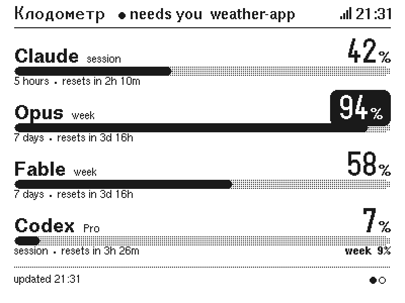

# Quota board

Claude and Codex quota on a 4.2" e-paper board on your desk. Opus, Fable and Codex by default,
one row each, no laptop needed to read it.

Hardware is the [RockBase NM-EPD-420](https://wiki.rockbaseiot.com/docs/products/nm-epd-420/):
ESP32-S3R8, 400×300 e-paper, two buttons.

The numbers come from [Agent Meter](https://github.com/kpeeem/agent-meter) over Bluetooth LE. The
Mac already collects these limits for its menu bar, so it pushes them to the board and the board
holds no tokens at all. Fetching them on the board, through a proxy, is still there as a fallback.


## Quick start

```bash
git clone git@github.com:kpeeem/nm-epd-420-quota.git && cd nm-epd-420-quota
```

Put the Wi-Fi password in the login keychain once, then generate `src/secrets.h` from it:

```bash
security add-generic-password -U -a 'Network' -s wifi-network-home -w '<wifi-password>'
```

```bash
./scripts/gen-secrets.sh
```

Plug the board in over USB and flash it:

```bash
~/.platformio/penv/bin/pio run -e quotaboard -t upload
```

The board joins Wi-Fi and shows three rows saying `waiting for Mac`. In Agent Meter open
**Settings → Quota board** and tick *Push the numbers to the quota board over Bluetooth*. Allow
Bluetooth when macOS asks. The board appears as `quotaboard`, and the next refresh fills the rows.

Everything else about the board — theme, which cards show, redraw interval, timezone — is in that
same pane, stored on the board. Hold **BOOT** for two seconds for the setup portal, which covers
Wi-Fi and the fallback as well.

After the first flash you never need the cable again:

```bash
./scripts/ota.sh
```

Two things make or break that, both learned the hard way:

- The partition table must have **two** app slots. `huge_app.csv` has only `app0`, so there is
  nowhere to write an incoming image and the board calls `abort()` a moment after the transfer
  starts — the host just sees a stall at 0%. This project uses `default_16MB.csv`, which gives two
  6.5 MB slots on the board's 16 MB flash. Changing the partition table needs one USB flash.
- The Mac firewall must let the uploader accept the inbound connection the board makes back to it.
  Symptoms otherwise are `No response from device`, or `Authenticating...OK` followed by a stall.

## What is on screen

| | |
|---|---|
| **Paper** — default | **Ink** |
|  |  |
| **Mono** — no red | **Second page** |
|  |  |

Each row is one quota window: the big number and the bar are the window you care about, the line
underneath says which window it is and when it resets. The Opus row carries the 5-hour session
number on the right, the Codex row carries its weekly number.

A row turns red at 90% — the bar and a chip behind the number. That is the only thing red means.

The header carries what your agents are doing right now: `working`, `done`, `failed`, or a dot and
`needs you` when a session is waiting on an answer or an approval, with the project beside it. The
panel repaints out of band for `needs you`, `done` and `failed` — at most once every two minutes,
since a redraw costs ten seconds — and otherwise waits for its own interval.

The footer shows when the numbers were last observed, optional indoor temperature and battery, and
page dots when a second page is enabled. On the fallback path it also shows the proxy exit country
(`via DE`).

### Buttons

| Button | Press | Does |
|---|---|---|
| USER | tap | next page |
| USER | hold | fetch now |
| BOOT | tap | help screen |
| BOOT | hold 2s | setup portal |


### Setup portal


Where the numbers come from, Wi-Fi, proxy, timezone, refresh interval, theme, tokens and which
cards appear. Tokens are written to the board's NVS and never echoed back to the browser — leave a
token field blank to keep what is already stored.

## Where the numbers come from

Agent Meter collects Claude and Codex limits for its own menu bar, and pushes that snapshot to the
board every time it refreshes. The board is a GATT server advertising as `quotaboard`:

| | UUID | |
|---|---|---|
| service | `ae4c9350-5442-48a2-8f62-288e8b34fc7c` | |
| quota | `ae4c9351-5442-48a2-8f62-288e8b34fc7c` | write |
| settings | `ae4c9352-5442-48a2-8f62-288e8b34fc7c` | read, write, notify |

The quota characteristic is write-only, so numbers cannot be read back off the board. Its payload
is JSON under 512 bytes, delivered as one ATT long write:

```json
{"v":1,"at":1763250000,
 "claude":{"state":"ok","session":[42.4,1763257850],"week":[61,1763570000],
           "opus":[94.2,1763570000],"sonnet":[37,1763570000],"fable":[58.6,1763570000]},
 "codex":{"state":"ok","plan":"Pro","session":[7.1,1763262400],"week":[9,1763750000]},
 "agent":{"state":"waiting","project":"NM-EPD-420","count":1}}
```

Every window is `[percent used, reset epoch]`, and a missing key just leaves that row empty.
`state` is one of `ok`, `stale`, `expired`, `limit`, `err`, `none`, and only reaches the screen when
a row has no number to show. `at` is when the Mac observed the numbers: it fills the footer stamp,
and it sets the board's clock when Wi-Fi never came up.

The settings characteristic carries the board's own configuration in both directions — source,
theme, cards, redraw interval, timezone, plus firmware version and IP to read — so the Settings
pane in Agent Meter edits exactly what the portal edits. The board notifies on every change, which
is how the pane follows a reboot or an edit made in the portal.

`agent` is what the sessions on the Mac are doing, from the hooks Agent Meter already installs:
`working`, `waiting` when one wants an answer or an approval, `done`, `failed`. It draws in the
header next to the wordmark, with a dot in front of `needs you`. The key is optional — without the
hooks the header just stays empty.

Pushes do not drive the panel directly. The board keeps the latest snapshot in RAM and repaints on
its own interval, immediately only for the first snapshot after boot and when numbers come back
after going `cached` — a 10 s full refresh on every push would leave it redrawing most of the time.

Nothing on this link is paired or encrypted. Anything in Bluetooth range can write a wrong number
to the panel or change the theme; nothing can read a number back, and there are no tokens to steal.

### Fallback: fetching on the board

Pick *This board, through the proxy* in the portal and the board fetches for itself, which is what
the tokens are for:

| Provider | Request | Token |
|---|---|---|
| Claude | `GET api.anthropic.com/api/oauth/usage` with `anthropic-beta: oauth-2025-04-20` | `~/.claude/.credentials.json`, or the login keychain item `Claude Code-credentials` |
| Codex | `GET chatgpt.com/backend-api/wham/usage` | `~/.codex/auth.json` → `tokens` |

Both are the same undocumented endpoints the official clients use, and both access tokens expire.
The board holds the refresh token too and renews against
`console.anthropic.com/v1/oauth/token` and `auth.openai.com/oauth/token`. Both providers **rotate**
refresh tokens, so the board writes the new one back to NVS on every renewal.

Two things to know before relying on this:

- `/api/oauth/usage` rate-limits hard — roughly a handful of requests per access token before it
  starts answering 429 ([claude-code#31637](https://github.com/anthropics/claude-code/issues/31637)).
  The default 20-minute interval is deliberate. On a 429 the board keeps the last good numbers and
  marks them `cached` rather than blanking the row.
- Refreshing with the official client id from an unusual network path can trip Cloudflare
  ([claude-code#47754](https://github.com/anthropics/claude-code/issues/47754)). If Claude rows go
  to `sign in again`, re-paste a fresh token in the portal.

## Networking

Wi-Fi is joined on both paths, because over-the-air updates need it: on the Bluetooth path it is
only for OTA and NTP, and the board still works with no Wi-Fi at all, taking the time from the Mac.

On the fallback path everything goes through an HTTP `CONNECT` proxy — the one set in the portal. The board opens a socket to the proxy, issues `CONNECT host:443`,
then runs a full mbedTLS handshake over that socket with certificate-bundle verification. The exit
country is probed once per cycle and shown in the footer, so a silently broken tunnel is visible
rather than guessed at.

Routers often publish the 2.4 GHz and 5 GHz bands under names that differ only in case. The radio is 2.4 GHz only,
so on a failed join the board rescans and matches the SSID case-insensitively.

## Builds

| Env | Panel | Refresh |
|---|---|---|
| `quotaboard` | tri-colour GDEY042Z98 | ~10 s full |
| `quotaboard-bw` | black/white GYE042A87 | ~0.4 s partial |
| `quotaboard-ota` | same as `quotaboard`, uploads over the air | |

This board has the **tri-colour GDEY042Z98**. The two panels look identical from the outside and
share an SSD1683-class controller, so the way to tell them apart is refresh timing rather than
markings: with `CORE_DEBUG_LEVEL=3` the driver prints how long it waited on BUSY, and this panel
reports `_Update_Fast : ~9960000` µs. A GYE042A87 completes its waveform in about 1.2 s and cannot
hold BUSY for ten seconds, so a ~10 s wait is positive identification of the tri-colour panel.

That costs ~10 s per redraw, which is why the per-minute clock update is off on this build. The
driver does expose `refresh_bw(x, y, w, h)` — a black/white differential update at ~1.5 s that
leaves the red plane alone — which is not wired up yet.

## Design on 1-bit

The panel has no grey, so grey is a 4×4 Bayer dither: bar tracks at ~19%, hairlines at ~37%. Text
is never dithered, and nothing is drawn on top of a dithered area — at this resolution a halftone
behind a glyph turns it to mush.

Type is U8g2 bitmap fonts, which are hinted at their design size and render crisply with no
antialiasing: `logisoso30` for the numbers, `helvB14`/`helvB10`/`helvB08`/`helvR08` for everything
else. The alert chip is sized from the font's real ascent rather than a guessed constant.

Layout is fixed geometry with right-aligned numbers, so values changing width never move anything.
The same `drawPage` runs for full and partial refreshes, which is what keeps partial updates
pixel-identical to a full redraw.

### Seeing the UI without a panel

A debug build renders into an off-screen two-plane canvas and dumps it over serial, which the host
turns into a PNG — every screenshot above was produced this way:

```bash
PLATFORMIO_BUILD_FLAGS="-DUI_MOCK=1" ~/.platformio/penv/bin/pio run -e quotaboard -t upload
```

```bash
python3 -I scripts/preview.py preview/overview.png m0d 40
```

The argument after the filename is a key sequence sent over serial: `m` mock data, `0`/`1`/`2`
theme, `p` next page, `d` dump page, `h` dump help, `s` dump portal.

## Layout of the source

| File | |
|---|---|
| `src/board.h` | pin map, from the vendor's `config.h` |
| `src/link.cpp` | BLE GATT server, quota and settings payloads |
| `src/net.cpp` | Wi-Fi, proxy CONNECT, mbedTLS, OTA, exit probe |
| `src/quota.cpp` | provider clients, OAuth refresh, response parsing |
| `src/ui.cpp` | themes, layout, dither, screens, preview dump |
| `src/portal.cpp` | setup portal |
| `src/settings.cpp` | NVS |

## Secrets

`src/secrets.h` is generated from the login keychain and is gitignored; `src/secrets.h.example`
shows its shape. It holds the Wi-Fi and OTA passwords, nothing else.

On the Bluetooth path the board stores no provider tokens whatsoever. They exist only for the
fallback, reach the board only through the setup portal, and are never in the repo or the build.
