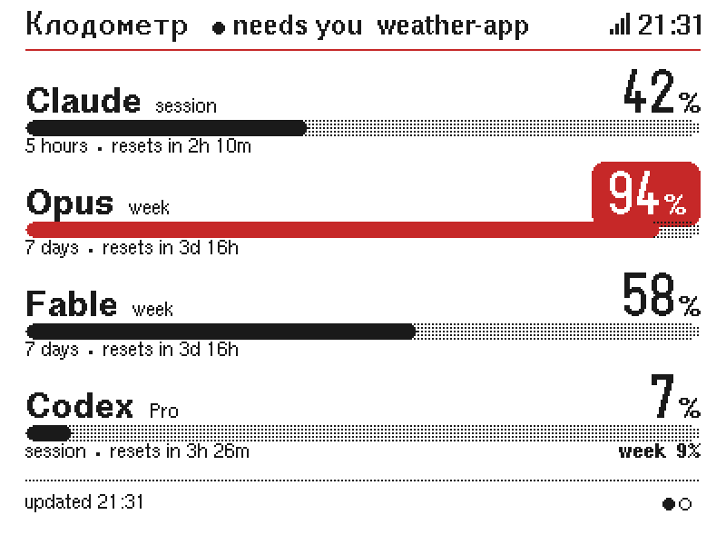
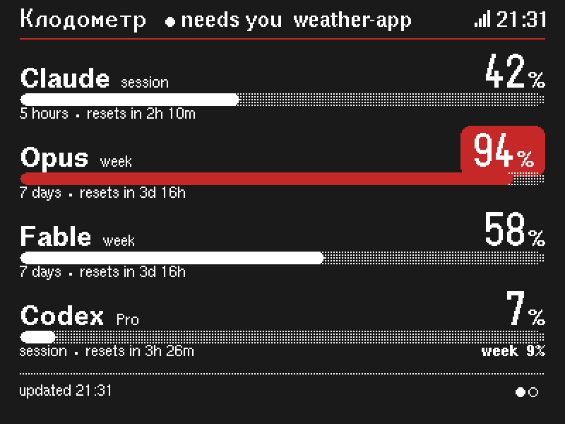
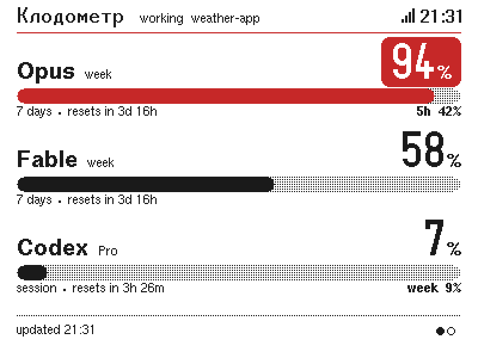
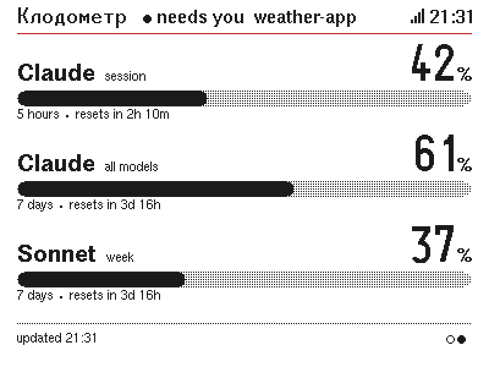
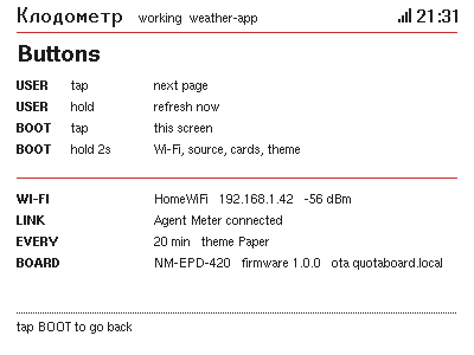
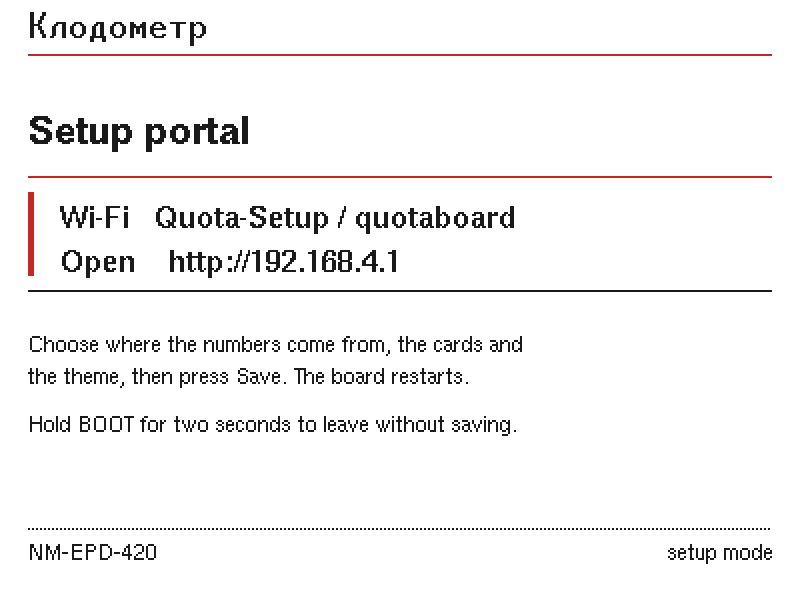

<p align="center">
  
</p>

<h1 align="center">Claudometer</h1>

<p align="center">
  Claude and Codex limits on a 4.2″ e-paper board on your desk.<br>
  Fed by <a href="https://github.com/kpeeem/agent-meter">Agent Meter</a> over Bluetooth, no tokens on the board.
</p>

<p align="center">
  <a href="https://github.com/kpeeem/claudometer/releases/latest"></a>
  <a href="https://github.com/kpeeem/claudometer/actions/workflows/firmware.yml"></a>
  
  
  <a href="LICENSE"></a>
</p>

<p align="center"><b>English</b> · <a href="README.ru.md">Русский</a></p>

> **TL;DR** — Take a [RockBase NM-EPD-420](https://wiki.rockbaseiot.com/docs/products/nm-epd-420/), flash `claudometer-<version>-3c.bin` from [Releases](https://github.com/kpeeem/claudometer/releases/latest) over USB, join the **Quota-Setup** Wi-Fi to set your network, then tick **Settings → Quota board** in [Agent Meter](https://github.com/kpeeem/agent-meter). The Mac pushes the same numbers it shows in the menu bar; the board stores no tokens.

## On the glass

| Paper | Ink | Mono |
| --- | --- | --- |
|  |  |  |
| **Three rows** — bigger numbers | **Second page** | **Help** — BOOT tap |
|  |  |  |

- One row per limit: Claude 5-hour, the week (Opus when Anthropic counts it), Fable and Codex. Choose them in Agent Meter or the portal.
- **Red means 90 % or more.** Nothing else is red.
- `cached` replaces the countdown when a reading is over an hour old or its window has already reset.
- The header shows what your agents do: `working`, `done`, `failed`, or **● needs you** with the project.

## Flash

**Release** — pick `-3c` for the tri-colour GDEY042Z98 panel or `-bw` for the black-and-white GYE042A87:

```bash
pip install esptool
esptool.py --chip esp32s3 write_flash 0x0 claudometer-1.0.0-3c.bin
```

**From source** — [PlatformIO](https://platformio.org/install/cli), Wi-Fi and OTA passwords from the macOS keychain:

```bash
git clone https://github.com/kpeeem/claudometer.git && cd claudometer
security add-generic-password -U -a 'MyWiFi' -s wifi-network-home -w '<wifi-password>'
security add-generic-password -U -a ota -s quotaboard-ota -w '<ota-password>'
WIFI_SSID=MyWiFi ./scripts/gen-secrets.sh
pio run -e quotaboard -t upload
```

After that, `./scripts/ota.sh` updates the board over Wi-Fi. Release builds have no OTA password, so their over-the-air updates stay off.

## Set up

1. On first boot, or after holding **BOOT** for 2 s, the board opens the **Quota-Setup** Wi-Fi (password `quotaboard`). Set your network at http://192.168.4.1.
2. In Agent Meter tick **Settings → Quota board → Push the numbers to the quota board over Bluetooth**. The board shows up as `quotaboard`.
3. Theme, rows, redraw interval and timezone live on the board; Agent Meter and the portal edit the same settings.

| Button | Tap | Hold |
| --- | --- | --- |
| **USER** | next page | fetch now |
| **BOOT** | help | setup portal (2 s) |



<details>
<summary><b>Bluetooth link</b></summary>

The board is a GATT server advertising as `quotaboard`. Nothing is paired or encrypted: anyone in range can write a wrong number, nobody can read one back.

| | UUID | |
| --- | --- | --- |
| service | `ae4c9350-5442-48a2-8f62-288e8b34fc7c` | |
| quota | `ae4c9351-5442-48a2-8f62-288e8b34fc7c` | write |
| settings | `ae4c9352-5442-48a2-8f62-288e8b34fc7c` | read, write, notify |

The quota payload is JSON under 512 bytes. Each window is `[percent used, reset epoch, seconds old]`:

```json
{"v":1,"at":1763250000,
 "claude":{"state":"ok","session":[42.4,1763257850],"week":[61,1763570000],"fable":[58.6,1763570000,14400]},
 "codex":{"state":"ok","plan":"Pro","session":[7.1,1763262400],"week":[9,1763750000]},
 "agent":{"state":"waiting","project":"weather-app","count":1}}
```

The board keeps the latest snapshot in RAM and repaints on its own interval: a full refresh of the tri-colour panel takes about 10 seconds.
</details>

<details>
<summary><b>Fallback: fetch on the board</b></summary>

Pick *This board, through the proxy* in the portal and the board asks `api.anthropic.com/api/oauth/usage` and `chatgpt.com/backend-api/wham/usage` itself, through an HTTP `CONNECT` proxy with TLS on top. Paste the OAuth tokens in the portal; they go to the board's NVS and never back to the browser. Both endpoints are undocumented, and the Claude one rate-limits hard, so the default interval is 20 minutes.
</details>

<details>
<summary><b>OTA notes</b></summary>

- The partition table needs two app slots: `default_16MB.csv` gives two 6.5 MB slots. Changing it takes one USB flash.
- The Mac firewall must accept the connection the board opens back to the uploader, or espota stalls at 0 %.
</details>

## Screenshots without a board

`ui.cpp` also compiles for the Mac against thin Arduino shims, so the screens above come from the real firmware code with demo numbers:

```bash
./scripts/render-previews.sh
```

A board on your network serves what is on the glass right now: `python3 -I scripts/preview.py now.png quotaboard.local`.

## Hardware

| | |
| --- | --- |
| Board | [RockBase NM-EPD-420](https://wiki.rockbaseiot.com/docs/products/nm-epd-420/): ESP32-S3R8, 16 MB flash, 400×300 e-paper, two buttons |
| Panels | `quotaboard` — tri-colour GDEY042Z98, ~10 s refresh · `quotaboard-bw` — black/white GYE042A87 |
| Case | `plate.3mf` — Bambu Studio plate: front bezel, rear cover and three button caps |

Built on [GxEPD2](https://github.com/ZinggJM/GxEPD2), [U8g2 for Adafruit GFX](https://github.com/olikraus/U8g2_for_Adafruit_GFX), [NimBLE-Arduino](https://github.com/h2zero/NimBLE-Arduino) and [ArduinoJson](https://arduinojson.org).

## License

The code in this repository is under the [MIT license](LICENSE). The flash images also contain [GxEPD2](https://github.com/ZinggJM/GxEPD2), which is GPL-3.0, so the images on the Releases page are distributed under GPL-3.0.
