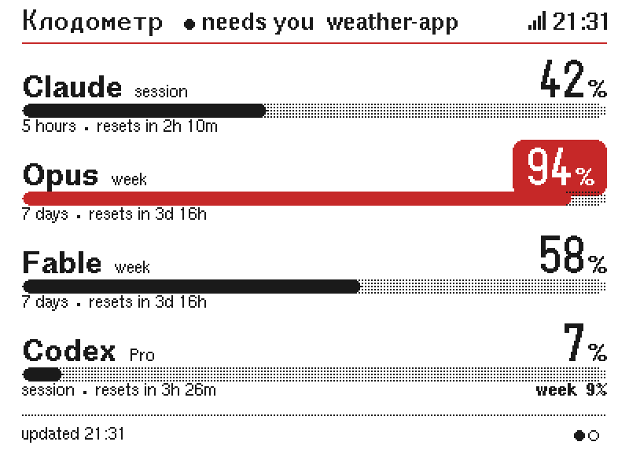
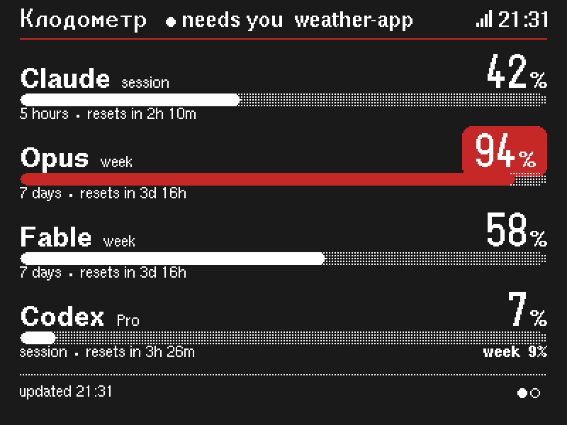
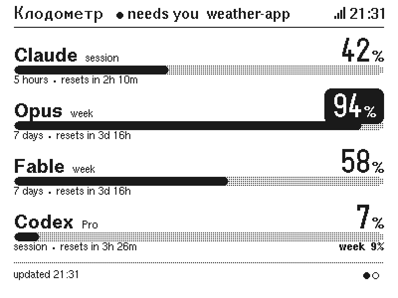
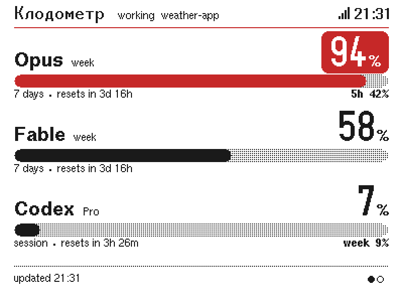
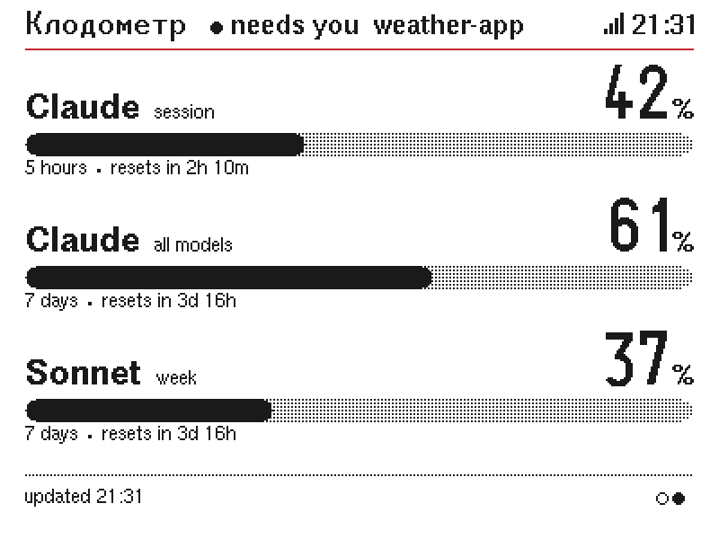
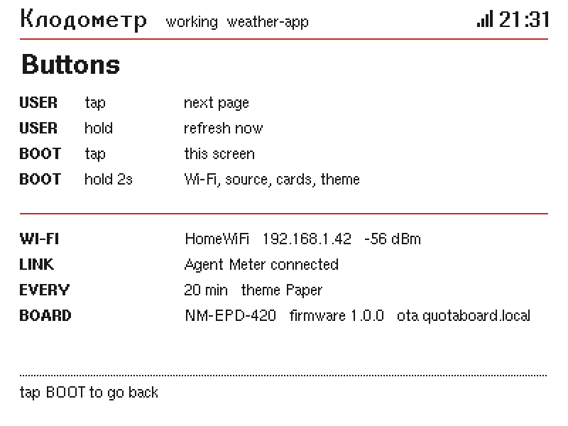
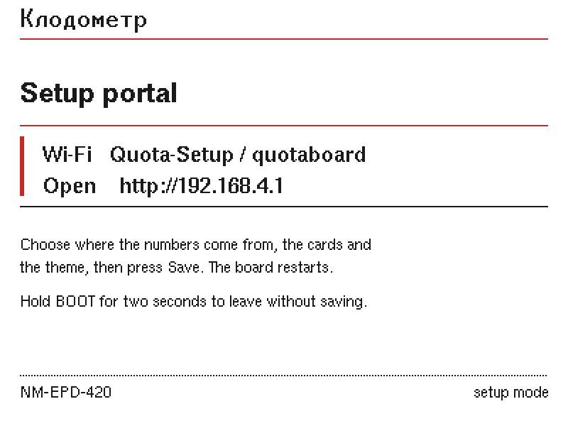

<p align="center">
  
</p>

<h1 align="center">Клодометр</h1>

<p align="center">
  Лимиты Claude и Codex на 4,2″ табло с электронной бумагой у тебя на столе.<br>
  Цифры приходят из <a href="https://github.com/kpeeem/agent-meter/blob/main/README.ru.md">Agent Meter</a> по Bluetooth, токенов на плате нет.
</p>

<p align="center">
  <a href="https://github.com/kpeeem/claudometer/releases/latest"></a>
  <a href="https://github.com/kpeeem/claudometer/actions/workflows/firmware.yml"></a>
  
  
  <a href="LICENSE"></a>
</p>

<p align="center"><a href="README.md">English</a> · <b>Русский</b></p>

> **TL;DR** — возьми [RockBase NM-EPD-420](https://wiki.rockbaseiot.com/docs/products/nm-epd-420/), прошей по USB `claudometer-<версия>-3c.bin` из [Releases](https://github.com/kpeeem/claudometer/releases/latest), подключись к Wi-Fi **Quota-Setup** и укажи свою сеть, потом включи **Настройки → Табло лимитов** в [Agent Meter](https://github.com/kpeeem/agent-meter/blob/main/README.ru.md). Mac передаёт те же цифры, что показывает в строке меню, а плата не хранит ни одного токена.

## Плата

<p align="center">
  
  
</p>
<p align="center"><sub>RockBase NM-EPD-420: ESP32-S3, электронная бумага 4,2″, кнопки, датчик температуры и зарядка LiPo в настольном корпусе. Фото: <a href="https://wiki.rockbaseiot.com/docs/products/nm-epd-420/">RockBase IoT</a></sub></p>

## На экране

| Бумага | Чернила | Моно |
| --- | --- | --- |
|  |  |  |
| **Три строки** — крупнее цифры | **Вторая страница** | **Справка** — нажатие BOOT |
|  |  |  |

- По строке на лимит: окно Claude на 5 часов, неделя (Opus, если Anthropic считает его отдельно), Fable и Codex. Набор выбирается в Agent Meter или на портале.
- **Красный — это 90 % и выше.** Больше красный ничего не значит.
- `cached` вместо обратного отсчёта: показание старше часа или его окно уже сбросилось.
- В шапке — чем заняты агенты: `working`, `done`, `failed` или **● needs you** с именем проекта.

## Прошивка

**Готовая сборка** — `-3c` для трёхцветной панели GDEY042Z98, `-bw` для чёрно-белой GYE042A87:

```bash
pip install esptool
esptool.py --chip esp32s3 write_flash 0x0 claudometer-1.0.0-3c.bin
```

**Из исходников** — [PlatformIO](https://platformio.org/install/cli), пароли Wi-Fi и OTA лежат в Связке ключей macOS:

```bash
git clone https://github.com/kpeeem/claudometer.git && cd claudometer
security add-generic-password -U -a 'MyWiFi' -s wifi-network-home -w '<пароль-wifi>'
security add-generic-password -U -a ota -s quotaboard-ota -w '<пароль-ota>'
WIFI_SSID=MyWiFi ./scripts/gen-secrets.sh
pio run -e quotaboard -t upload
```

Дальше `./scripts/ota.sh` обновляет плату по Wi-Fi. В релизной сборке пароля OTA нет, поэтому обновление по воздуху там выключено.

## Настройка

1. При первом запуске или если подержать **BOOT** 2 секунды, плата поднимает Wi-Fi **Quota-Setup** (пароль `quotaboard`). Сеть настраивается на http://192.168.4.1.
2. В Agent Meter включи **Настройки → Табло лимитов → Передавать цифры на табло лимитов по Bluetooth**. Плата видна как `quotaboard`.
3. Тема, строки, интервал перерисовки и часовой пояс хранятся на плате; Agent Meter и портал правят одни и те же настройки.

| Кнопка | Нажатие | Удержание |
| --- | --- | --- |
| **USER** | следующая страница | обновить сейчас |
| **BOOT** | справка | портал настройки (2 с) |



<details>
<summary><b>Связь по Bluetooth</b></summary>

Плата — GATT-сервер с именем `quotaboard`. Ни пары, ни шифрования: любой рядом может записать неверную цифру, но прочитать цифры с платы нельзя.

| | UUID | |
| --- | --- | --- |
| сервис | `ae4c9350-5442-48a2-8f62-288e8b34fc7c` | |
| лимиты | `ae4c9351-5442-48a2-8f62-288e8b34fc7c` | запись |
| настройки | `ae4c9352-5442-48a2-8f62-288e8b34fc7c` | чтение, запись, notify |

Снимок лимитов — JSON до 512 байт. Каждое окно — `[процент, время сброса, возраст в секундах]`:

```json
{"v":1,"at":1763250000,
 "claude":{"state":"ok","session":[42.4,1763257850],"week":[61,1763570000],"fable":[58.6,1763570000,14400]},
 "codex":{"state":"ok","plan":"Pro","session":[7.1,1763262400],"week":[9,1763750000]},
 "agent":{"state":"waiting","project":"weather-app","count":1}}
```

Плата держит последний снимок в памяти и перерисовывается по своему интервалу: полное обновление трёхцветной панели занимает около 10 секунд.
</details>

<details>
<summary><b>Запасной путь: плата спрашивает сама</b></summary>

Если выбрать на портале *This board, through the proxy*, плата сама ходит в `api.anthropic.com/api/oauth/usage` и `chatgpt.com/backend-api/wham/usage` через HTTP-прокси `CONNECT` с TLS поверх. OAuth-токены вставляются на портале, сохраняются в NVS платы и обратно в браузер не отдаются. Оба адреса недокументированные, а Claude жёстко ограничивает частоту запросов, поэтому интервал по умолчанию — 20 минут.
</details>

<details>
<summary><b>Про OTA</b></summary>

- В таблице разделов нужны два слота под приложение: `default_16MB.csv` даёт два по 6,5 МБ. Смена таблицы требует одной прошивки по USB.
- Файрвол Mac должен пускать обратное соединение от платы к загрузчику, иначе espota встаёт на 0 %.
</details>

## Скриншоты без платы

`ui.cpp` собирается и на Mac с тонкими заглушками Arduino, поэтому экраны выше нарисованы настоящим кодом прошивки на демо-цифрах:

```bash
./scripts/render-previews.sh
```

Плата в твоей сети отдаёт то, что сейчас на экране: `python3 -I scripts/preview.py now.png quotaboard.local`.

## Железо

| | |
| --- | --- |
| Плата | [RockBase NM-EPD-420](https://wiki.rockbaseiot.com/docs/products/nm-epd-420/): ESP32-S3R8, 16 МБ флеша, электронная бумага 400×300, две кнопки |
| Панели | `quotaboard` — трёхцветная GDEY042Z98, обновление ~10 с · `quotaboard-bw` — чёрно-белая GYE042A87 |
| Корпус | `plate.3mf` — стол Bambu Studio: передняя рамка, задняя крышка и три кнопки |

Собрано на [GxEPD2](https://github.com/ZinggJM/GxEPD2), [U8g2 for Adafruit GFX](https://github.com/olikraus/U8g2_for_Adafruit_GFX), [NimBLE-Arduino](https://github.com/h2zero/NimBLE-Arduino) и [ArduinoJson](https://arduinojson.org).

## Лицензия

Код в этом репозитории под [лицензией MIT](LICENSE). В образы прошивки входит [GxEPD2](https://github.com/ZinggJM/GxEPD2) под GPL-3.0, поэтому образы со страницы Releases распространяются на условиях GPL-3.0.
